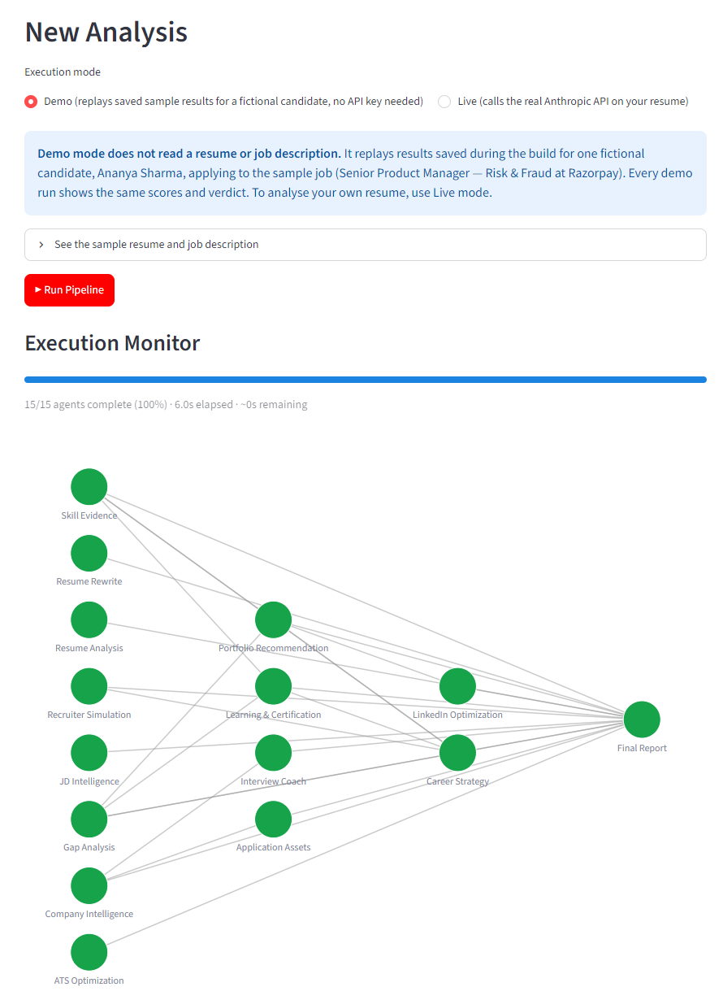

# Career Copilot

**An AI assistant for job applications. You give it a resume and a job posting. Eighteen AI agents, each with one job, turn them into a tailored application package: a match analysis, ATS check, rewritten resume versions, company research, interview prep and outreach drafts, followed by a final ready / not-ready verdict.**



*The dashboard in Demo mode. Every agent node turned green, meaning it finished.*

| | |
|---|---|
| **What it is** | A working prototype: a Python multi-agent pipeline with a Streamlit dashboard. |
| **Try it** | **[career-copilot-gold-six.vercel.app](https://career-copilot-gold-six.vercel.app)**: Demo mode, no sign-up. It replays the fictional sample and saves nothing about you. |
| **Status** | Demo mode runs end to end without an API key. Live mode, which calls Anthropic's API with your own key, exists in the code but has **no recorded runs** in this repository. |
| **Not yet shown** | Accuracy on real resumes, time saved, or any user testing. |
| **Product owner** | Bhawna Mangla. Built with AI (Claude Code). |
| **More** | [PRD and status](docs/PRD.md) · [Decision log](docs/decisions.md) · [Changelog](CHANGELOG.md) · [Technical reference](docs/TECHNICAL.md) · [Lessons learned](docs/portfolio/LESSONS_LEARNED.md) |

---

## Problem

A serious job application takes hours of scattered work (an estimate; not measured). You have to:
- work out what the posting really screens for;
- research the company;
- judge your fit honestly;
- tailor a resume without breaking applicant-tracking (ATS) parsing;
- prepare interview answers;
- draft outreach.

Generic AI chat can do each step, but it tends to invent achievements and skills to make a resume look better. That failure is worse than being unhelpful: a made-up claim surfaces in the interview, in front of the person deciding whether to hire you.

Career Copilot is built around the opposite rule: **every claim must trace back to the resume, the posting, or a cited source, and when there is no evidence the system says so instead of filling the gap.**

**Intended users** (from the [full PRD](docs/product/PRD.md)): job seekers applying to specific roles; career changers who want an honest read on where they stand.

> **OWNER INPUT NEEDED:** what made you build this? For example, your own job search, or watching others use ChatGPT for applications. The repo records no user research. If there was none, say so.

## Why AI, and why not just rules

The repo does not record whether a rules-based tool was tried first. This is how the work is split between the model and plain code:

| Job | Who does it | Why |
|---|---|---|
| Reading a resume and a posting, finding gaps, rewriting bullets, drafting answers and outreach | Claude, one agent per job | Resumes and postings are free text in every format. Judging what counts as evidence for a skill is a reading task, not a keyword match. |
| Company research, learning resources, salary context | Claude with web search, then a second call to structure the answer | These are facts about the real world that change. A model's memory is out of date, so these agents search and must cite sources. |
| Checking the agents' work | Claude (the Critic and Supervisor agents) | They read the other agents' outputs and re-add the numbers. |
| Output format of every agent | **Plain code** (Pydantic schemas) | Each agent must return data in a fixed shape. A reply that doesn't fit is rejected, so no agent parses another's prose. |
| What order agents run in | **Plain code** reads a shared registry of agents and what each needs | The Planner agent picks which agents to run. The order comes from the registry, not from the model, and a name that isn't in the registry stops the run with an error. |
| Spend limit, Live-mode passcode, privacy on a public server | **Plain code** | These must not depend on a model's judgement. |

**Where rules would do better, and aren't used yet:** the ATS score is produced by the model and only checked to be between 0 and 100. The Critic re-adds it, but that is one model checking another. Arithmetic like this could be computed in code. (Proposal, not built.)

## Key decisions and tradeoffs

Full log with dates and sources: [docs/decisions.md](docs/decisions.md).

1. **Eighteen narrow agents instead of one big prompt.** *Gave up:* simplicity and cost. A full run makes many model calls. *Got:* each agent has one schema and one sample, so it can be checked on its own, and the Critic can compare agents against each other.
2. **"No evidence" is a field value, not just a prompt instruction.** Fields can be empty, and placeholders like `[Recruiter Name]` are part of the format. For example, Interview Coach returns no story at all when the resume has nothing to support one. *Gave up:* outputs that always look complete. *Got:* the gap shows instead of being papered over.
3. **Research in two steps.** Agents that need real-world facts search the web in one call, then a second call without search shapes the result. *Gave up:* one call per agent. *Got:* a research gap and a formatting error can be told apart. The output keeps sourced facts separate from assumptions.
4. **A shared registry of agents.** The Planner, Critic and Supervisor all read one machine-readable list of agents and what each needs, instead of each having its own description in a prompt. The Critic checks every agent name it reviews against it. *Gave up:* nothing much, but the registry must be kept in step with the agents by hand.
5. **The system drafts; the user sends.** It never submits an application or sends a message. *Gave up:* automation. *Got:* the person stays responsible for what goes out under their name.
6. **The public demo replays one fictional sample.** *Gave up:* letting visitors try their own resume on the hosted site. *Got:* no API cost, no key on a public server, and nothing stored about visitors.
7. **Spend limit and passcode for Live mode.** An optional cap stops a run the moment estimated cost reaches it, before any further agent is called. An optional passcode locks Live mode on a shared server.

## How I measured quality

**What is tested.** `python scripts/smoke_test.py` runs offline, with no API key, on every push in GitHub Actions. Re-run locally on 19 Oct 2026: **20 of 20 checks pass.**

| Check | Result | How |
|---|---|---|
| All 18 sample outputs match their agents' data formats | 18 of 18 | Smoke test, in CI |
| Full pipeline runs in Demo mode | 15 specialists completed, 0 failed, verdict produced | Smoke test, in CI |
| Demo mode runs the sample, not what a visitor uploads | Pass | Smoke test; browser, 18 Oct 2026 |
| Public mode stores nothing about a visitor | No database file, no output files, no run log; all 7 sidebar pages load in public mode | Smoke test; browser |
| Hosted demo on Vercel | Demo run completes, all 24 downloads work, history pages off | Headless browser on the live link, 18 Oct 2026 (Demo mode only) |
| Live mode against the real API | **Not checked.** No key was used and no live-run records are in the repo. The default model ID in the code (`claude-sonnet-5`) is unconfirmed. | — |

The smoke test proves the plumbing: formats, run order, privacy. **It does not test whether the advice is any good.**

**The Critic's review of the sample run.** The Critic agent read all 15 specialist outputs for the fictional candidate and re-added every number it could check:


- **It found one real bug.** The learning-plan agent said "~45–55 hours" in total, but its own four line items add up to 30–44 hours. The sample was fixed after the review ([critic output](outputs/critic_sample_output.md)).
- Other re-added numbers matched: the ATS score (100 − 8 − 6 − 4 = 82), gap counts, evidence counts, a placeholder count and a 300-character limit.
- Its other ratings, such as 91/100 overall and "hallucination risk: low", are **one AI model's judgement of another's work** on one sample. They are not accuracy measurements.

**What is not measured:** the quality of the output on real resumes. An evaluation harness exists ([`career_copilot/evals/`](career_copilot/evals/)). It runs test cases through an agent and has a second model score each one for accuracy and invented facts. It has **no test cases written and no results**, and running it needs an API key. That is why this repo has no `evals/` folder yet.

**Proposed eval set (draft, not run):** 20–30 cases for the agents where invention does the most damage (Resume Rewrite, Interview Coach, Gap Analysis). Each case would be a synthetic resume and posting where the right answer is known:
- *Easy and normal:* a well-matched resume. Does the rewrite keep every fact?
- *Missing evidence:* the posting asks for a skill the resume never mentions. Does the agent say "no evidence", or invent it?
- *Bait:* a vague resume line ("worked on payments"). Does the rewrite add a metric or scope that isn't there?
- *Bad input:* an empty resume, or a posting in another language.
- *Mismatch:* a nurse resume against a Rust engineering job. Does it say plainly that this is a poor fit?

Scoring would be a pass or fail per case on "every claim traces to the input", checked by a person, with the model judge's score alongside so the two can be compared.

> **OWNER INPUT NEEDED:** run the cases with your own API key (I don't handle keys), or confirm the plan so the cases can be written for you to run.

## Failure modes and guardrails

| What can go wrong | Guardrail | Proven by |
|---|---|---|
| An agent invents an achievement, metric or credential | Instructions forbid it; "no evidence" is a valid output; the Critic checks for it | Only on the one sample. Not measured on real resumes. **This is the main open risk.** |
| A rewrite inflates scope ("Managed" becomes "Owned") | The Resume Rewrite agent is told to keep facts; the Critic looks for inflated verbs | The Critic flagged exactly this in the sample's "Startup" version as a minor issue |
| A stated total doesn't match its own parts | The Critic re-adds the numbers | Caught the learning-plan bug in the sample |
| Company facts are out of date or wrong | Web search first; sourced facts kept separate from assumptions | The sample cites public news about Razorpay; those sources were not re-checked |
| An agent's reply isn't in the expected format | Rejected by its schema | Smoke test: 18 of 18 samples match |
| The Planner names an agent or dependency that doesn't exist | Run order comes from the shared registry; an unknown name stops the run with an error rather than being guessed at | The Planner's sample plan was checked against the registry when it was built (`422fde5`) |
| A Live run gets expensive | Optional spend cap stops the run immediately; optional passcode | Code path exists; **not exercised against the real API** |
| Visitors on a shared server see each other's resumes | `PUBLIC_DEPLOYMENT=1` saves nothing and turns history off | Smoke test; browser; the hosted demo runs this way |
| Someone reads the demo result as an analysis of their own resume | Demo mode hides the upload fields and says it replays one fictional candidate | Smoke test; browser |
| A candidate repeats AI-written lines they can't back up in an interview | **None in the system.** This is about how people use it, and is listed as a risk in [RISKS.md](docs/product/RISKS.md). | — |

## Users and iteration

**No users are recorded.** All outputs are for one fictional candidate (Ananya Sharma, Senior Product Manager, Risk & Fraud at Razorpay; [sample resume](samples/sample_resume.txt), [sample job description](samples/sample_jd.txt)).

**What changed after a review on 18 Oct 2026**, when the repo was checked against its own claims:

| Before | After | Commit |
|---|---|---|
| Demo mode replayed the sample whatever you uploaded, and saved it under your name. A nurse resume against a Rust job came back "ATS 82, ready". | Demo mode hides uploads and says plainly that it replays one fictional candidate | `e138067` |
| On a shared server, any visitor could open any other visitor's resume | `PUBLIC_DEPLOYMENT=1` stores nothing and turns history off | `e138067`, `b5dafad` |
| A dashboard card called "Success Rate" | Renamed "Marked Ready": it counts runs the Supervisor marked ready, not job-search success | `df439dc` |
| "6–8 hours per role" | "Hours (an estimate; not measured)": the figure had no source | `d9433f5` |
| The sample resume had a realistic-looking email, phone number and LinkedIn URL | Reserved example values | `80c1073` |
| No automated checks | Offline smoke test on every push | `48cbbe1` |

> **OWNER INPUT NEEDED.** Did anyone other than you run it on a real application? What did they say?
>
> **"I was wrong about…" candidates from the build record** (pick one and say it in your own words, or replace it):
> - *The Critic:* per [LESSONS_LEARNED](docs/portfolio/LESSONS_LEARNED.md), its first pass approved 14 of 15 agents. A reviewer that always says "looks good" isn't checking. It only caught a real bug once it had a mechanical task: re-add every total. (The git history holds only the final version of the Critic, so the earlier pass isn't in the repo.)
> - *Prompts alone:* per the same notes, "never invent facts" in the instructions wasn't enough. Models filled gaps anyway until "no evidence" became an allowed value in the format.
> - *The demo:* it looked like a working analysis of anyone's resume, but it always returned the sample's answer. A visitor could have believed a nurse resume was "ready" for a Rust job.

## What's next

1. **Record one Live run** with a real key on the sample, and publish the cost, time and output next to the demo. Confirm the default model ID first.
2. **Write and run the 20–30 case eval set** above, and publish the pass rate for invented claims.
3. **Test with three to five real job seekers** on real postings, and record what they changed before sending.
4. **Compute checkable numbers in code** (ATS score arithmetic, totals) instead of asking the model.
5. **Flag borderline wording for the user to confirm** (for example "Managed" to "Owned") instead of the rewrite deciding alone.
6. **Re-record the deck and video.** They predate the October review; see the note in [`docs/presentation/`](docs/presentation/).

## How I built it

Product owner, built with AI (Claude). The agents, pipeline, dashboard, sample outputs and first docs were written by Claude Code in July 2026, almost all on 10 Jul (27 of 34 commits up to the October review), with Bhawna Mangla (GitHub [bhawnamanglapm](https://github.com/bhawnamanglapm); earlier commits appear as Bhavu211) directing the build, reviewing and merging. She added the dev container. The October review, the privacy fixes, the smoke test and the Vercel deployment were also done with Claude Code.

> **OWNER INPUT NEEDED:** confirm or edit this line before publishing: *"Implemented with Claude Code; I owned the problem framing, architecture decisions, evals and testing."* The repo shows what was built and when, but not who decided what. Note that no evals have been run yet, so "evals" may need to come out of that sentence for now.

**Stack:** Python, the Anthropic SDK, Pydantic, Streamlit, Plotly, SQLite; hosted on Vercel. Details in the [technical reference](docs/TECHNICAL.md).

## Run it yourself

```bash
pip install -r requirements.txt
streamlit run dashboard/app.py          # opens at http://localhost:8501
python scripts/smoke_test.py            # offline checks
```

- **Demo mode** (default) needs no key. It replays the saved sample for the fictional candidate and ignores uploads.
- **Live mode** analyses your own resume. Set `ANTHROPIC_API_KEY` first. Each run makes billed API calls, including web search.
- **Sharing the app with others?** Set `PUBLIC_DEPLOYMENT=1`, or every visitor can see every other visitor's resume and results. Also consider `LIVE_MODE_PASSCODE` and `LIVE_MODE_COST_LIMIT_USD`. Details: [dashboard/README.md](dashboard/README.md), including [deploying on Vercel](dashboard/README.md#deploying-on-vercel) (Live runs may be cut off after 5 minutes on the free plan).

**Limits:** no logins; one fictional sample is the only worked example.

## Documentation

- [`docs/product/`](docs/product/): full PRD, user stories, roadmap, risks, competitive analysis.
- [`docs/agents/`](docs/agents/): one page per agent.
- [`docs/portfolio/`](docs/portfolio/): problem statement, architecture, lessons learned, a screenshot of each agent's report.
- [`docs/TECHNICAL.md`](docs/TECHNICAL.md): code layout, running the pipeline and agents from Python, engineering design decisions.
